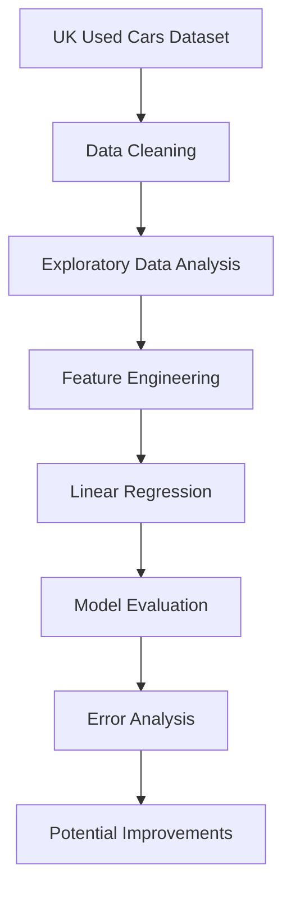

# Used Car Price Prediction — Data Science Project

## Overview

How much is a used car worth? This project explores how vehicle characteristics can be used to estimate resale prices using data analysis, feature engineering, and multiple linear regression.

Developed as part of the *Introduction to Data Processing* course at Polytech Nice Sophia, this project applies a complete data science workflow to real-world used car listings from the UK.

The dataset combines listings from seven car brands: Audi, BMW, Ford, Hyundai, Skoda, Toyota, and Volkswagen.

## Objectives

- Explore and understand real-world vehicle data.
- Clean and preprocess the dataset.
- Identify relationships between car characteristics and resale prices.
- Create engineered features to improve predictive performance.
- Train and evaluate a multiple linear regression model.
- Analyze prediction errors and identify potential improvements.

## Dataset

The project uses the **UK Used Cars dataset**, obtained from Kaggle and combining seven brands.

| Property | Description |
|---|---|
| Original dataset size | 72,435 listings |
| Final dataset size | 71,593 listings |
| Number of brands | 7 |
| Target variable | Used car price |
| Main features | Age, mileage, engine size, fuel type, transmission, tax, and fuel consumption |

The dataset includes numerical and categorical variables describing each vehicle.

## Methodology

### 1. Data Cleaning and Preprocessing

The preprocessing stage includes:

- Removing 842 duplicate listings.
- Converting the registration year into vehicle age.
- Checking for unrealistic vehicle ages.
- Grouping the very rare electric category into `Other`.
- Encoding categorical variables using One-Hot Encoding.
- Preparing a strategy for handling missing values using the median for numerical features and the mode for categorical features.

The vehicle model column was excluded from the regression because its 146 distinct values would significantly increase the number of features.

### 2. Exploratory Data Analysis

Data visualization was used to understand the distribution of prices and the relationships between vehicle characteristics.

The analysis highlights several patterns:

- Used car prices are strongly right-skewed.
- Engine size is positively correlated with price (\(r = 0.63\)).
- Vehicle age is negatively correlated with price (\(r = -0.52\)).
- Mileage is negatively correlated with price (\(r = -0.43\)).
- Premium brands such as Audi and BMW have higher median prices.

Visualizations include price distributions, categorical variable distributions, correlation matrices, and price comparisons across brands.

### 3. Feature Engineering

Several new variables were created to capture relationships between existing features.

The most effective engineered feature was:

\[
\text{cylindree\_sur\_age}
=
\frac{\text{engine size}}{\text{vehicle age}+1}
\]

This feature combines engine size and vehicle age to represent the relationship between engine power and depreciation.

It achieved a correlation of approximately **0.85 with price** and improved the model's cross-validated \(R^2\) by approximately 0.07.

Other tested features included:

- `km_fois_age`: mileage multiplied by age.
- `age_carre`: squared vehicle age.
- `cylindree_fois_age`: engine size multiplied by age.
- `mpg_sur_age`: fuel consumption divided by age plus one.

### 4. Linear Regression

A multiple linear regression model was trained to predict used car prices from the selected features.

The model uses:

- Vehicle age.
- Mileage.
- Engine size.
- Fuel consumption.
- Encoded transmission and fuel type.
- The engineered `cylindree_sur_age` feature.

The model was evaluated using an 80/20 train-test split and five-fold cross-validation.

## Results

The final model achieved the following performance:

| Metric | Result |
|---|---:|
| Test \(R^2\) | 0.80 |
| Test RMSE | €4,188 |
| Test MAE | €2,763 |
| Five-fold cross-validation \(R^2\) | \(0.72 \pm 0.04\) |

The model explains approximately 80% of the variance in the test set, while the cross-validation results provide a more conservative estimate of generalization performance.

Predictions are more accurate for vehicles priced below approximately €40,000. The model tends to underestimate expensive vehicles and can occasionally predict negative prices, highlighting limitations of linear regression for this highly skewed target variable.

## Technologies Used

- **Python**
- **Pandas** — data manipulation and preprocessing
- **NumPy** — numerical operations
- **Matplotlib** — data visualization
- **Seaborn** — statistical visualizations
- **Scikit-learn** — linear regression, preprocessing, and model evaluation

## Project Workflow

## Limitations and Future Improvements

Several improvements could make the model more accurate:

- Apply a logarithmic transformation to the target price to reduce the impact of extreme values.
- Include car brand as an additional predictive feature.
- Investigate alternative regression models capable of capturing nonlinear relationships.
- Evaluate performance separately for different price ranges.
- Improve predictions for luxury vehicles and prevent negative price estimates.

---

*Academic project — Introduction to Data Processing, MAM3, 2025–2026. Université Côte d'Azur, Polytech Nice Sophia.*
